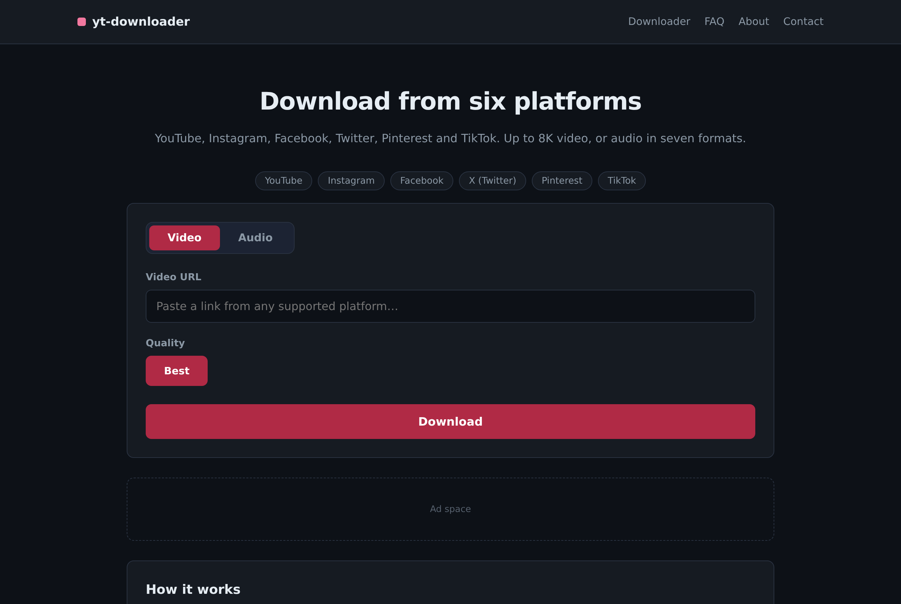
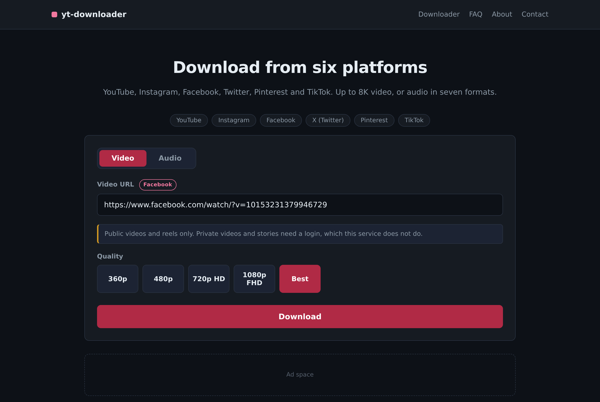
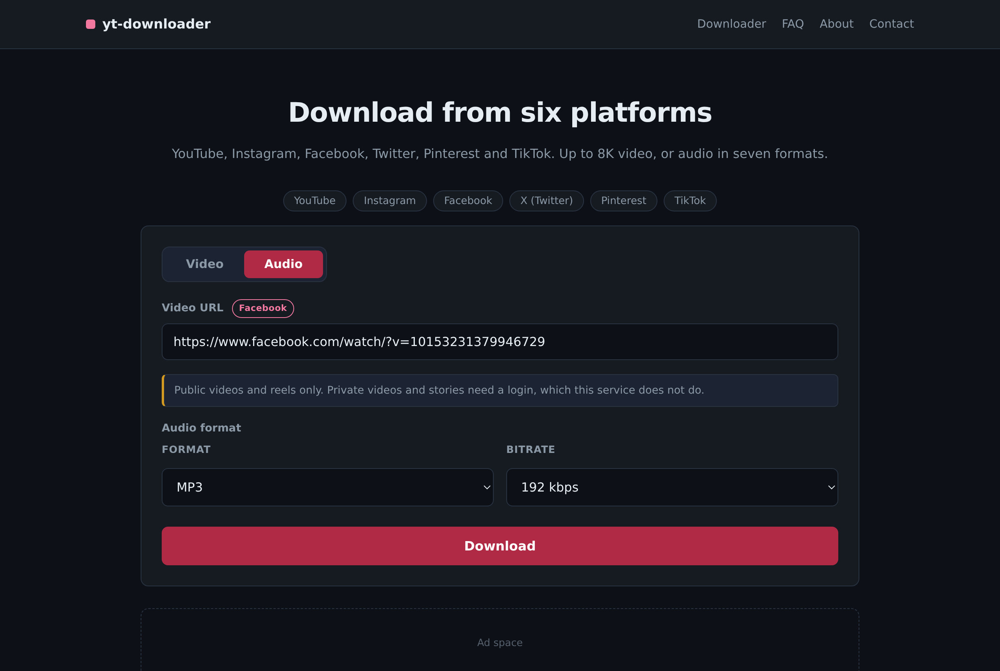
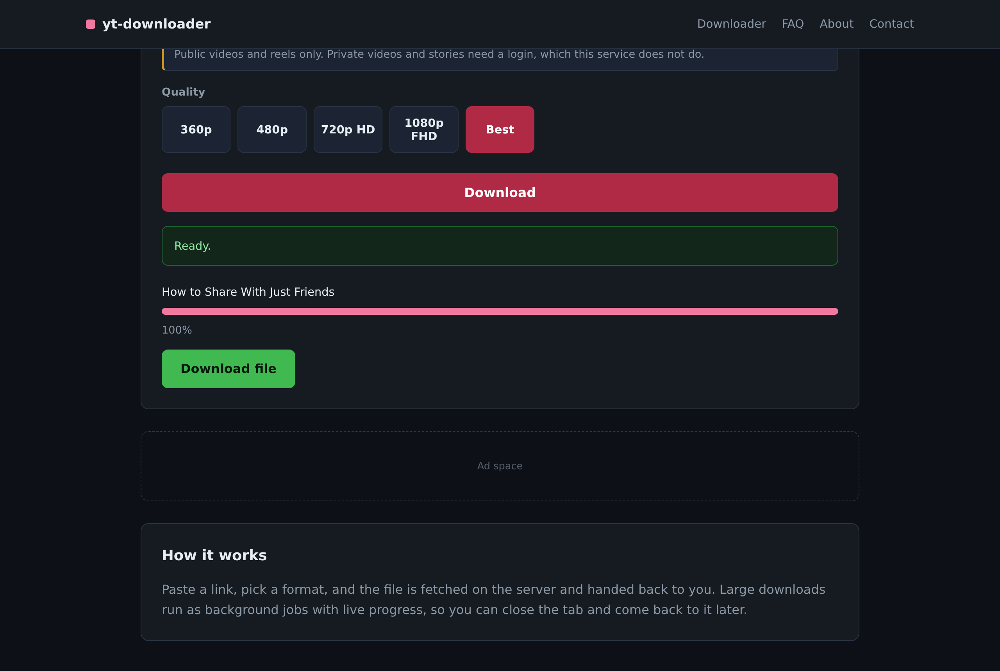
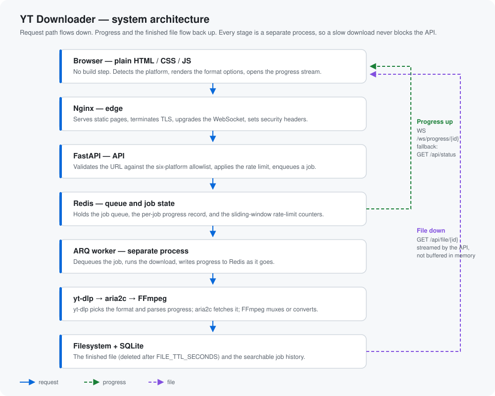
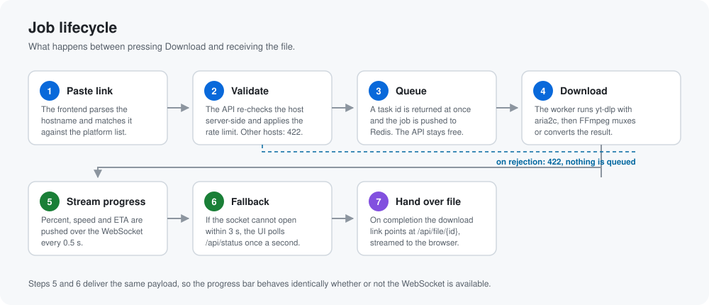
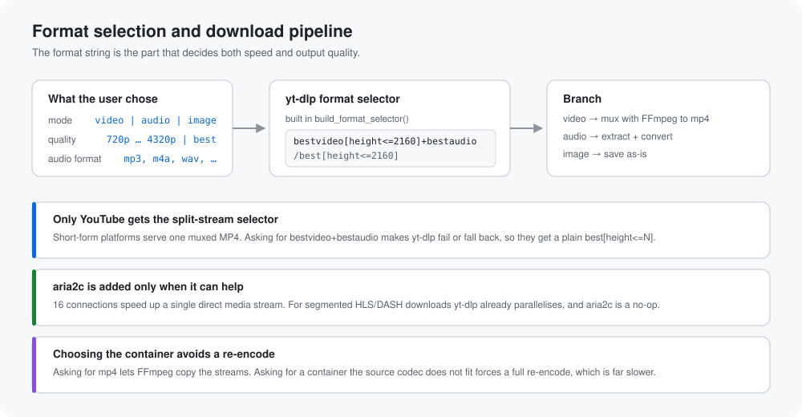
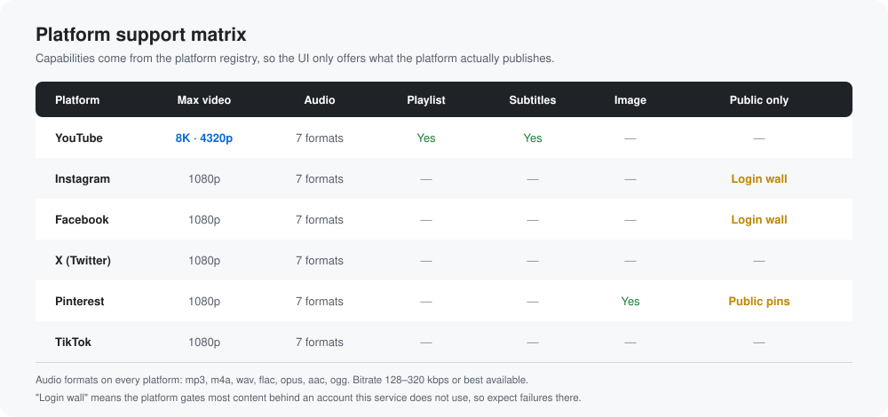

# YT Downloader

[](https://github.com/NSKWeb/yt-downloader/actions/workflows/ci.yml)
[](backend/tests)
[](backend/requirements.txt)
[](LICENSE)

A fast multi-platform video and audio downloader. Paste a link, pick a format,
get the file.

Supported platforms: **YouTube, Instagram, Facebook, Twitter/X, Pinterest, TikTok.**



*The home page. The mode toggle (Video / Audio / Image) is rendered from the
platform registry, so a platform that publishes no separate audio stream never
shows an Audio tab it cannot honour.*

## Contents

- [What it does](#what-it-does)
- [Screenshots](#screenshots)
- [Colour and accessibility](#colour-and-accessibility)
- [Stack](#stack)
- [Architecture](#architecture)
- [How the download logic works](#how-the-download-logic-works)
- [Platform support matrix](#platform-support-matrix)
- [API examples](#api-examples)
- [Endpoints](#endpoints)
- [Quick start](#quick-start)
- [Configuration](#configuration)
- [Tests](#tests)
- [Deployment notes](#deployment-notes)
- [Subdomain architecture](#subdomain-architecture)
- [Security](#security)
- [What this project does not do](#what-this-project-does-not-do)
- [Licence](#licence)

## What it does

- Video from 360p up to 4320p (8K), where the source provides it
- Audio extraction in MP3, M4A, WAV, FLAC, OPUS, AAC, and OGG, with selectable
  bitrate
- Per-platform format selection, so single-file sources are not asked for
  separate video and audio streams they do not have
- Multi-connection fetching via aria2c
- Background jobs on a queue, so long downloads survive a closed tab
- Live progress, speed, and ETA over a WebSocket, with polling fallback
- Per-IP rate limiting and a searchable download history

See [PLAN.md](PLAN.md) for the full feature breakdown.

## Screenshots

All four are real captures of the running stack, not mockups.

| Platform detected | Audio options |
|---|---|
|  |  |

*Left: pasting a link resolves the host against the allowlist and swaps the
quality grid for that platform's own ladder — a short-form platform offers up to
1080p, YouTube up to 4320p. Right: audio mode replaces the quality grid with a
format selector and a bitrate selector (128–320 kbps, or best available).*



*Completion. The task ran as a queued job; the API returned a task id
immediately and the UI watched it. At 100% the progress bar is replaced by a
direct link to `/api/file/{task_id}`.*

## Colour and accessibility

The accent is a rose (`#f2789f`), not a saturated red. Bright red on a dark
surface is hard to look at for long — it vibrates against the background, and it
is the colour people are trained to read as "error", which is the wrong signal
for a normal primary action.

One variable cannot serve both roles, so the palette splits them:

| Token | Value | Used for | Contrast |
|-------|-------|----------|----------|
| `--accent` | `#f2789f` | Link text, borders, progress fill, chips | 7.18:1 on `--bg` |
| `--accent-solid` | `#b02a45` | Filled buttons and active tabs, under white text | 6.44:1 against white |
| `--accent-hover` | `#c9334b` | Hover state for the filled buttons | 5.17:1 against white |

This is not cosmetic. The previous `--accent: #ff0033` measured **3.96:1**
against white text on the primary button, below the WCAG AA threshold of 4.5:1.
The rose pair clears AA in both directions, so the same token is safe as body
text on the dark background and as a button surface under white text. The error
alert was softened to a rose tint as well (`#3a1a20` on `#ffc9d2`, 10.78:1) so
it stays distinguishable from the accent without shouting.

All colours live in the `:root` block of `frontend/assets/style.css`. Change
them there; no page or script hardcodes a colour.

## Stack

| Layer | Technology |
|-------|------------|
| Frontend | Plain HTML/CSS/JS, no build step |
| API | FastAPI |
| Download engine | yt-dlp + aria2c |
| Muxing / conversion | FFmpeg |
| Queue | ARQ + Redis |
| Process manager | Gunicorn + Uvicorn |
| Reverse proxy | Nginx |
| Deployment | Docker Compose |

## Architecture



The request travels down through six stages, each a separate process. Progress
and the finished file travel back up along the two return paths on the right.

| Stage | Responsibility | Why it is separate |
|-------|----------------|--------------------|
| Browser | Detect the platform, render the format options, open the progress stream | Plain JS, no build step, so the served file is the source file |
| Nginx | Static pages, TLS, WebSocket upgrade, security headers | Keeps the API free of static-file work and centralises headers |
| FastAPI | Validate the URL, apply the rate limit, enqueue the job | Request handling stays fast; a slow download never blocks a response |
| Redis | Job queue, per-job progress record, rate-limit counters | The only shared state between the API and the workers |
| ARQ worker | Run the download, write progress as it goes | Downloads are long and CPU-heavy; isolating them protects the API |
| yt-dlp / aria2c / FFmpeg | Resolve formats, fetch bytes, mux or convert | Mature tools that are better at their job than reimplementing them |

The important consequence: the API returns in milliseconds, and the download
runs somewhere else entirely. Nothing about a 4 GB transfer is holding a
request open.

### Job lifecycle



Progress is pushed over a WebSocket. If the socket cannot be established — a
proxy that strips upgrades, a locked-down network — the frontend falls back to
polling `/api/status` and the user sees the same information. Both paths deliver
an identical payload, which is why the fallback needs no separate UI.

## How the download logic works



The whole speed story lives in one function, `build_format_selector()`, which
turns the user's mode and quality into a yt-dlp `-f` expression.

**Only YouTube gets the split-stream selector.** YouTube publishes video and
audio as separate tracks, so `bestvideo[height<=2160]+bestaudio` downloads each
at its best and FFmpeg muxes them. Every other supported platform serves a
single already-muxed MP4; asking those for `bestvideo+bestaudio` makes yt-dlp
fail or silently fall back, so they get a plain `best[height<=N]`.

**aria2c is added only when it can help.** Sixteen parallel connections speed up
a single direct media stream. They do nothing for a segmented HLS/DASH download,
because yt-dlp already fetches those segments in parallel. The command builder
therefore checks for the binary and only then appends the downloader arguments.

**The container choice avoids a re-encode.** Asking for mp4 lets FFmpeg copy the
streams (`-c copy`) instead of transcoding them. Asking for a container the
source codec does not fit forces a full re-encode, which is far slower and loses
quality.

The progress path is the other half. yt-dlp is run with `--newline` and
`--progress`, its stdout is read line by line, and each line is parsed for
percentage, speed, and ETA. Those values are written to the job record in Redis,
which the WebSocket and the polling endpoint both read. One writer, two readers,
no shared in-process state.

A second `--print` template emits a `before_dl` line carrying the title and size
estimate, so the UI can show a real filename and a size before the first byte
lands. It uses the ASCII unit separator (`\x1f`) as the field delimiter, because
video titles routinely contain spaces and tabs.

## Platform support matrix



The UI only offers what the platform actually publishes, so nobody selects 4K on
a platform that caps at 1080p and wonders why the result is 1080p. Two platforms
are marked "public only" because they gate most content behind an account this
service deliberately does not use; the UI warns instead of failing mysteriously.

## API examples

Every payload below was captured from the running stack.

### Queue a download

```bash
curl -X POST http://localhost:12000/api/download \
  -H 'Content-Type: application/json' \
  -d '{"url":"https://www.youtube.com/watch?v=aqz-KE-bpKQ","mode":"video","quality":"2160p"}'
```

```json
{ "task_id": "95c6dd49ab80463abd8a6463837b4fad", "status": "queued" }
```

The call returns immediately. The download has not started yet — it has been
placed on the queue.

### Watch progress over the WebSocket

```bash
# with websocat, or any WS client
websocat ws://localhost:12000/ws/progress/95c6dd49ab80463abd8a6463837b4fad
```

```json
{"task_id":"95c6dd49ab80463abd8a6463837b4fad","platform":"facebook","status":"queued","progress":0.0,"speed":null,"eta":null,"title":null,"filesize":null,"error":null}
{"task_id":"95c6dd49ab80463abd8a6463837b4fad","platform":"facebook","status":"downloading","progress":0.0,"speed":null,"eta":null,"title":null,"filesize":null,"error":null}
{"task_id":"95c6dd49ab80463abd8a6463837b4fad","platform":"facebook","status":"complete","progress":100.0,"speed":null,"eta":null,"title":"How to Share With Just Friends","filesize":5388007,"error":null}
```

`speed` and `eta` are populated only while a transfer is genuinely in flight.
This clip is 5 MB on a fast link, so it finishes before a sample lands; a large
download reports them every 0.5 s.

### Poll instead, if the socket is blocked

```bash
curl http://localhost:12000/api/status/95c6dd49ab80463abd8a6463837b4fad
```

Same payload as the socket, which is what makes the fallback transparent.

### Read metadata without downloading

```bash
curl 'http://localhost:12000/api/info?url=https://www.facebook.com/watch/?v=10153231379946729'
```

```json
{
  "title": "How to Share With Just Friends",
  "uploader": "Facebook",
  "duration": 74,
  "thumbnail": null,
  "webpage_url": "https://www.facebook.com/watch/?v=10153231379946729",
  "formats_available": []
}
```

### Collect the file

```bash
curl -OJ http://localhost:12000/api/file/95c6dd49ab80463abd8a6463837b4fad
```

The API streams the file; it is not buffered in memory. The file is deleted
after `FILE_TTL_SECONDS`.

### What a rejection looks like

A host outside the allowlist is refused before any job exists:

```bash
curl -X POST http://localhost:12000/api/download \
  -H 'Content-Type: application/json' \
  -d '{"url":"https://evil.example.com/video.mp4"}'
```

```json
{
  "detail": [{
    "type": "value_error",
    "loc": ["body", "url"],
    "msg": "Value error, Unsupported host. Supported: facebook.com, fb.watch, instagram.com, ...",
    "input": "https://evil.example.com/video.mp4"
  }]
}
```

`HTTP 422`. Nothing is queued, and no request is ever made to that host.

## Endpoints

| Method | Path | Purpose |
|--------|------|---------|
| GET | `/api/health` | Liveness check |
| GET | `/api/platforms` | Supported platforms and their options |
| POST | `/api/download` | Queue a download |
| GET | `/api/status/{task_id}` | Progress, speed, ETA, status |
| GET | `/api/file/{task_id}` | Download the finished file |
| GET | `/api/history` | Recent jobs |
| DELETE | `/api/history/{task_id}` | Remove a history entry |
| GET | `/api/info?url=` | Metadata preview (title, duration, thumbnail) |
| WS | `/ws/progress/{task_id}` | Live progress stream |

## Quick start

### Docker (recommended)

```bash
git clone <your-repo-url>
cd yt-downloader
cp backend/.env.example backend/.env
docker compose up --build
```

Open <http://localhost:12000>.

### Local development

Requires Python 3.12+, FFmpeg, aria2, and a running Redis.

```bash
# Redis
redis-server --daemonize yes

# API
cd backend
python -m venv .venv && source .venv/bin/activate
pip install -r requirements.txt

export DOWNLOAD_DIR=/tmp/downloads REDIS_HOST=127.0.0.1
uvicorn app.main:app --reload
```

In a second terminal, start the worker:

```bash
cd backend
source .venv/bin/activate
export DOWNLOAD_DIR=/tmp/downloads REDIS_HOST=127.0.0.1
arq app.workers.tasks.WorkerSettings
```

Then serve `frontend/` however you like, e.g. `python -m http.server 8080`.

## Configuration

All settings come from environment variables. See
[`backend/.env.example`](backend/.env.example) for the full list.

| Variable | Default | Purpose |
|----------|---------|---------|
| `DOWNLOAD_DIR` | `/downloads` | Where finished files are written |
| `FILE_TTL_SECONDS` | `3600` | How long a file is retained |
| `REDIS_HOST` / `REDIS_PORT` | `redis` / `6379` | Queue backend |
| `ARIA2C_CONNECTIONS` | `16` | Connections per server |
| `ARIA2C_SPLIT` | `16` | File split count |
| `ARIA2C_CONNECT_TIMEOUT` | `60` | aria2c connect timeout, seconds |
| `ARIA2C_TIMEOUT` | `60` | aria2c per-read timeout, seconds |
| `MAX_CONCURRENT_JOBS` | `2` | Worker concurrency |
| `RATE_LIMIT_PER_MINUTE` | `10` | Requests allowed per IP per minute |
| `RATE_LIMIT_PER_HOUR` | `100` | Requests allowed per IP per hour |
| `RATE_LIMIT_ENABLED` | `true` | Turn the limiter off entirely |
| `DATABASE_PATH` | `<DOWNLOAD_DIR>/history.db` | SQLite history location |
| `HISTORY_ENABLED` | `true` | Record job history |
| `WS_POLL_INTERVAL` | `0.5` | Seconds between progress reads |
| `CORS_ORIGINS` | `*` | Allowed frontend origins |

## Tests

```bash
cd backend
pip install -r requirements.txt
python -m pytest -q      # 130 tests
ruff check app tests     # lint
```

Tests cover URL validation, platform detection, per-platform format-selection
logic, audio bitrate mapping, progress parsing, job lifecycle, rate limiting,
history recording, path-traversal rejection, metadata coercion, and the absence
of bot-bypass flags. `ruff` and `pip-audit` also run in CI.

## Deployment notes

- **Datacenter IPs.** YouTube, and sometimes Twitter/X, refuse requests from
  datacenter IP ranges with a "Sign in to confirm you're not a bot" message.
  That is expected, not a bug: it is the platform declining the host, not the
  code failing. Run this on a residential or well-reputed host, or keep the
  volume low. Instagram and Pinterest can return `403` to a datacenter IP for
  the same reason.
- **aria2c can abort where yt-dlp would have finished.** Google's video hosts
  occasionally reset a connection mid-transfer, and aria2c gives up on it. This
  was observed on a large YouTube fetch. Lower `ARIA2C_CONNECTIONS` for those
  hosts, or drop the aria2c downloader entirely for a retry.
- **Platforms break, and yt-dlp fixes them.** A Facebook video returned
  `Cannot parse data` during testing because the extractor was behind a site
  change. The fix is `pip install -U yt-dlp`, not a code change here. Pin and
  update it deliberately.
- **Bandwidth.** Proxying files costs egress. 10,000 downloads averaging 1.5 GB
  is 15 TB of traffic. Budget for it or run it privately.
- **Legal.** Downloading is lawful only for content you have the right to save.
  You are responsible for how this tool is used. See the
  [DMCA](frontend/dmca.html) and [Disclaimer](frontend/disclaimer.html) pages.

## Subdomain architecture

The nginx server block uses `server_name _`, so one container answers for the
apex domain and for every platform subdomain
(`youtube.example.com`, `tiktok.example.com`, and so on). Add a wildcard DNS
record (`*.example.com`) and a wildcard certificate; no per-subdomain nginx
block is needed.

What the subdomain does and does not do:

- **Does:** set `request.state.subdomain_platform`, so a handler can default to
  that platform and the mapping can be logged. The frontend can pre-select the
  matching tab.
- **Does not:** grant any access. A request to `youtube.example.com` carrying a
  TikTok URL is validated against the URL allowlist exactly like any other
  request, and the Host header is never used for an authorization decision.

This matters because the `Host` header is attacker-controlled. Treating it as a
trust signal is how host-header injection becomes an open redirect or a cache
poisoning bug. Here it is a display hint only.

## Security

- **URL allowlist.** Only the six supported platforms' hosts are accepted; every
  other host is rejected before a job is queued, so the API cannot be pointed at
  an arbitrary URL.
- **Path-traversal rejection.** `/api/file/{task_id}` resolves the task's
  recorded filename inside the download directory and rejects anything that
  escapes it.
- **Rate limiting.** Sliding-window counters per client IP, in Redis.
- **Response headers.** `X-Content-Type-Options`, `X-Frame-Options`, and
  `Referrer-Policy` are set at the edge, and `server_tokens` is off.
- **Dependency audit.** `pip-audit` runs in CI and currently reports no known
  vulnerabilities.
- **No secrets in the image.** Configuration comes from the environment; only
  `.env.example` is committed.

## What this project does not do

By design, and stated plainly so nobody has to guess:

- No `player_client` spoofing or Proof-of-Origin token generation to defeat
  YouTube's bot detection.
- No proxy rotation or residential proxies to evade IP blocks.
- No cookie-based authentication to reach age-restricted content.
- No ad code is injected into the pages. The legal pages exist, but wiring up
  AdSense to monetise a downloader is a decision with real consequences, so it
  is left to the operator.

These are access-control measures, not speed features. Removing them costs no
performance: aria2c multi-connection, format pre-selection to avoid re-encoding,
and the async queue are where the speed actually comes from.

## Licence

MIT. See [LICENSE](LICENSE).
